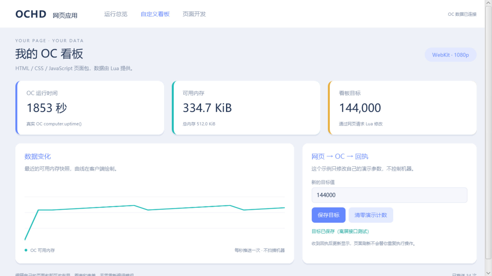
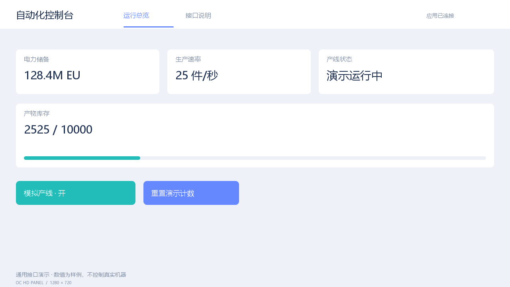
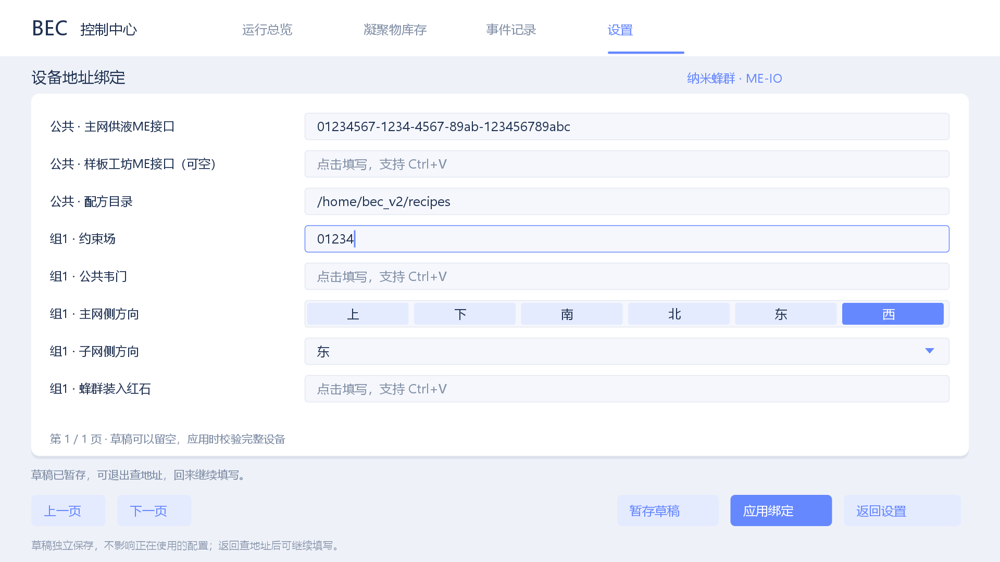

# OCHD HTML 应用原型（开发分支）

新增 [HTML页面包与OC通信接口](docs/HTML_APPS.md)：玩家上传HTML/CSS/JavaScript，Lua推送数据、接收事件；独立WebKit客户端渲染。Windows x64 + Java21测试包，版本0.4.0-alpha2-html，尚未GTNH实机验收。

[下载HTML原型](https://github.com/Alivn-chao/oc-hd-panel/releases/tag/v0.4.0-alpha2-html) · [继续使用原绑定版](https://github.com/Alivn-chao/oc-hd-panel/releases/tag/v0.3.2-alpha4-drafts)



# OC 高清屏幕：alpha4 本地绑定

新增：[页面内绑定、断点草稿与 Ctrl+V 输入](docs/BINDINGS.md)，支持V2配置及V1高清监控连接。交付以用户提供的1080p alpha4为基准，保留已有修复；原公开alpha3下载继续保留。

[下载 alpha4 绑定测试版](https://github.com/Alivn-chao/oc-hd-panel/releases/tag/v0.3.2-alpha4-drafts) · [原 alpha3](https://github.com/Alivn-chao/oc-hd-panel/releases/tag/v0.3.0-alpha3) · [通用接口文档](docs/API.md)



面向 GTNH 2.9.0 beta3 / OpenComputers 1.12.61-GTNH 的通用高清屏幕附属模组。新放置的屏幕显示欢迎页；你的 OC Lua 程序定义页面、数据和按钮。可以制作电力、仓储、产线或其他自动化的控制台。BEC 页面是可选适配器。

界面借鉴网页的卡片、标签、按钮和操作回执，alpha4客户端用 Java2D 绘制1920×1080纹理，Lua布局仍使用1280×720逻辑坐标。它是原生游戏方块与GUI，不执行HTML/CSS/JavaScript。

## 安装与使用

1. 关闭客户端和服务器，用本版 `oc-hd-panel-0.3.1-alpha4-bindings.jar` 替换旧版jar，两端使用相同版本。绑定操作详见上方独立指南。
2. 在 NEI 搜索“OC 高清面板”。临时测试配方：第一排 3 个玻璃，第二排 铁锭/红石/铁锭，第三排 3 个铁锭。
3. 放置时正面朝向放置者。同朝向、同一平面、相邻的高清面板组成完整矩形后，约 20 个服务器 tick 内自动拼为一面屏幕墙；最大 8 列 × 6 行。建议先搭完整屏幕，再接入 OC 电脑并运行程序。
4. 用 OC 线缆连接屏幕墙。拼接后只有一个可见的 `hd_panel` 组件。不要给同一面墙同时绑定多个程序或电脑；已分别绑定的屏幕不会直接合并。改变形状前先停止程序并 `release()`，完成后重新枚举组件地址。
5. 将 `oc/automation_demo.lua` 复制到**游戏 OC 电脑** `/home/automation_demo.lua`，运行 `lua /home/automation_demo.lua`。这是模拟数据，不访问真实机器。Q 退出并解除绑定。
6. 右键墙上任意高清面板打开紧凑窗口，默认宽度约为游戏窗口的 45%，周围仍可见游戏世界。F6 切换大窗口，Esc 关闭；打开 GUI 不暂停服务器。

只有本模组新增的高清面板能互相拼接，不能与原版 OC 屏幕混拼。不完整矩形、超过尺寸上限、朝向不同或多个独立绑定者会保留为单屏；方块被拆除后会重新计算。原版 OC 屏幕与显卡仍按原来的方式工作。

拼屏扩大世界中的物理显示面积，共用一张1920×1080画布，按16:9等比居中；宽高比不同会留边，并不为每块各建一张图像。Lua逻辑坐标保持1280×720。墙上右键打开GUI，目前没有世界表面坐标触摸事件。

## 接入自己的自动化

组件名 `hd_panel`。`setUI()` 定义布局，`updateUI()` 提供实时值；玩家点击按钮后，绑定电脑收到 `hd_panel_event`，由自己的 Lua 程序处理并调用 `ack()`。首次调用绑定当前电脑，其他电脑不能覆盖它的页面。

```lua
local component = require("component")
local event = require("event")
local p = component.hd_panel  -- 仅有一面墙时；多面墙用明确地址 proxy
assert(p.setUI({title="电力监控", pages={
  {id="main",label="总览",widgets={
    {id="energy",type="value",x=40,y=124,w=500,h=112,label="储能",unit=" EU"},
    {id="refresh",type="button",x=40,y=270,w=240,h=60,label="刷新"}
  }}
}}))
-- setUI 后等至少 10 个服务器 tick；这里用事件等待让电脑继续处理信号。
event.pull(0.6)
p.updateUI({energy={text="128.4M"},refresh={enabled=true}})
-- 收到 hd_panel_event, 地址, 控件ID, 玩家名, 请求编号, 数值
-- 处理后：p.ack(请求编号, true, "读取完成")
-- 持续运行的程序应定期 updateUI，完整循环见 automation_demo.lua。
```

[接口文档](docs/API.md)列出控件、坐标、频率和事件字段。默认提供文字、数值卡片、进度条、按钮、开关，最多 4 页 / 32 个控件。`release()` 解除绑定并保留最后页面；`clearUI()` 清空数据、回到欢迎页并解除绑定。旧 BEC 页面也可通过这两个方法退出和清空。

界面只负责显示与发送请求，不会自行连接 AE、BEC 或其他机器。自动化程序要自行读取组件、判断是否允许操作、执行动作并回执。按钮默认禁用，只有对应值明确 `enabled=true` 且应用在线才可用。客户端显示状态不代替 Lua 的动作校验。

## 可选 BEC 适配器


将 `oc/bec_hd.lua` 放到 `/home/bec_hd.lua`。公开版还需把 `oc/bec_hd.config.example` 复制为游戏 OC `/home/bec_hd.config`，把 `node` 和 `field` 两个示例 UUID 改为自己的 BEC 传送节点与约束场完整组件地址（在 OC 中用 `components` 查看）；配置文件只保留在自己的 OC 电脑上。它复用已有 `/home/bec_ui.lua`、`bec_auto.lua` 和相关补丁，不会替换它们。

先进行只读验证：

```sh
lua /home/bec_hd.lua monitor
```

此模式所有控制按钮禁用；显示每 2 秒读取一次传送节点和约束场状态、以及现有日志/缓存配置，不调用 AE 全网库存扫描，也不启动原 UI 或控制器。只读模式无需显卡；控制模式仍要保留原 OC 屏幕与显卡，因为现有 `bec_ui.lua` 需要它们。

确认显示正常后，在原 UI 按 Q 正常停止原服务，避免重复启动控制器。随后根据原日志的正常恢复流程选择：

```sh
# 原程序正常停止、日志为 stopped：
lua /home/bec_hd.lua run

# 原程序在未完成的阶段退出，使用已有恢复入口：
lua /home/bec_hd.lua resume
```

多块高清面板时，指定组件地址或唯一前缀：

```sh
lua /home/bec_hd.lua monitor 屏幕地址
```

按钮行为：

- 刷新：请求下一次状态快照，依然受组件频率限制。
- 处理样板：映射到已有 UI 的 S 键；仅运行原样板流程。
- 暂停：映射到已有 UI 的 Q 键，按原流程停止服务。适配器保留连接，方便之后恢复。
- 恢复：UI 仍运行时映射到 T 重试键（需要已安装原暂停面板补丁）；UI 已退出时根据日志的 `stopped` 状态选择原 run/resume 入口。没有绕过原控制器的恢复核对。

第一版显示实际并行、蜂群等级/数量、节点状态、凝聚物库存、缓存目标、阶段变化与连接状态。配方进度只在调用方提供真实 `progress/progressMax` 时显示；BEC 适配器没有可靠的进度来源，会明确显示“当前驱动未提供配方进度”。演示图里的进度是样例。事件记录是适配器事件和阶段变化，不是完整控制器日志。前 5 条库存显示在首页，库存页滚轮或拖动滚动条查看全部；组件最多接收 32 条。

## BEC 交互与配置

`oc/hd_panel_demo.lua` 是旧 BEC 样式的演示，`oc/automation_demo.lua` 是通用接口演示。启动前者或 `bec_hd.lua` 才会切换到 BEC 页面。原 BEC 总览、库存滚动、事件、设置及输入框仍可使用。

暂停、恢复和样板处理先确认再提交；输入框支持 Ctrl+A/C/V、方向键、Home/End、退格、Delete 和预设。默认缓存目标范围 1–2147483647 mB。先暂停并等待原控制器退出，再保存默认目标。单项覆盖值保持原样，包括单项 0 停补。新目标由新补库计划读取，未完成计划仍按原日志恢复。

配置保存先写同目录临时文件、flush/关闭并读回核对，再备份旧配置并移入新配置。备份名为 OC `/home/bec_cache.config.hd.bak.请求编号`；移入失败会尝试恢复原配置并报错。若断电使配置缺失，须从备份恢复 `/home/bec_cache.config` 后再运行。适配器不会覆盖无法解析的原配置。

刷新回执表示已请求快照；样板/恢复回执表示已交给原入口；暂停回执在原 UI 返回后给出。真实机器结果仍需检查状态与日志。

## 性能与验证

- 服务器同步有上限的布局和数值，不生成图像、不按像素发包。数据最多每 10 个服务器 tick 接受一次（20 TPS 时每秒 2 次），相同数据不重复同步。
- 客户端单个后台线程绘制，任务队列容量 8；数据画面至少间隔 500ms，GUI 切页最快 33ms。悬停直接绘制边框，未变画面复用纹理。
- 每面墙共用一张纹理，客户端最多缓存 4 面墙；超过容量的新墙暂不生成纹理，避免每帧分配和回收。世界显示距离上限 32 格，GUI 距墙超过 8 格关闭，卸载或远离时回收缓存。
- 单张RGBA1080p纹理约7.91MiB，另有像素缓冲和临时绘制图像。单次点击墙级串行等待OC回执；服务器160tick/GUI12秒分别超时，低TPS时实际动作可能较晚发生。关闭GUI不撤销已提交请求。
- 100 个服务器 tick 未收到更新（20 TPS 时 5 秒），应用显示离线、禁用按钮并保留最后数据。

已完成编译、13 项 Java 测试及 Lua 模拟检查，真实游戏内拼接、事件路由、多人权限、区块卸载和 FPS/MSPT 尚未验证。本版为预发行 Alpha，不保证固定帧率。预览由实际绘图代码生成，使用演示数据，不是游戏截图。

## 源码构建

JDK 25 运行 Gradle 9.4.1，JDK 21 编译为 Java 8 字节码（RFG 2.0.5 构建插件需要 Java 25）。将自己实例中的 `OpenComputers-1.12.61-GTNH.jar` 放到 `libs/`，不将其打进发布 jar。

```sh
./gradlew -Porg.gradle.java.installations.paths="/path/to/jdk21" test reobfJar
```

最终安装包由 `tools/package_alpha4_bindings.py` 生成到 `build/distributions/`，不要使用`-dev.jar`或跳过原包保留验证。Python测试另加`tools/test_bindings.py`。`tools/GenericPreview.java`和`tools/Preview.java`使用实际绘图代码生成预览；已有旧预览来自alpha3。

中文字体优先使用系统微软雅黑，其他平台需提供支持中文的系统字体。公开仓库不包含原 BEC 控制器、OC 模组 jar 或服务器专用组件地址。


