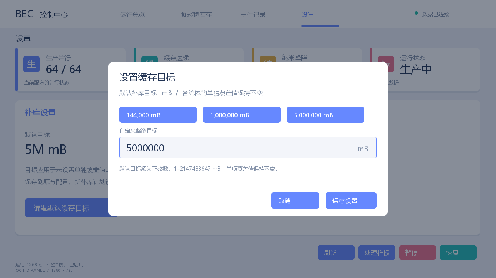

# OC 高清面板 0.2.0-alpha2

[下载 Alpha 测试版](https://github.com/Alivn-chao/oc-hd-panel/releases) · [验证记录](docs/VALIDATION.md)



为 GTNH 2.9.0 beta3 / OC 1.12.61-GTNH 制作的交互版。原生游戏方块，客户端使用 Java2D 生成 1280×720 界面，再由 Minecraft 渲染纹理。没有内嵌浏览器。

这是待游戏实测的 Alpha 构建；编译、Lua 模拟测试与界面图片检查不能代替实机兼容性、FPS 和 TPS 验证。

## 新版交互与升级

界面借鉴 HTML 控制台，使用原生组件实现，提供固定 BEC 页面模板。目前不执行任意 HTML/CSS/JavaScript。

升级时关闭客户端与服务器，把旧 alpha1 jar 移出 mods，再放入同一份 alpha2 jar。同步更新游戏 OC `/home/bec_hd.lua` 和 `/home/hd_panel_demo.lua`，旧适配器没有操作回执，搭配新版会等待超时。原 `/home/bec_ui.lua` 等控制器文件保持原样。

- 鼠标移到可用按钮、标签和链接时显示边框与提示。
- 库存支持滚轮、可拖动滚动条；演示脚本提供 19 条样例库存。
- 暂停、恢复和样板处理先弹窗确认，再提交。Enter 确认，Esc 取消。
- 设置页有 144000 / 1000000 / 5000000 mB 预设和输入框，支持 Ctrl+A/C/V、方向键、Home/End、退格和 Delete。目前只接受数字，默认目标范围 1–2147483647 mB。
- 提交后显示等待、OC 回执或失败，等待时阻止重复提交。12 秒墙钟等待超时表示结果尚未确认；服务器按 tick 计时，低 TPS 时可能稍后执行。关闭 GUI 不撤销已提交的操作。

演示与 monitor 模式只允许查看和预览设置，保存禁用。控制模式中先暂停原服务并等待回执，再保存默认目标；Lua 再次核对控制器已经返回。全部单项覆盖值保持原样，包括单项 0 停补。新目标由新补库计划读取，未完成计划仍按原日志恢复。

保存配置时先写同目录临时文件、flush/关闭并读回核对，再备份旧配置并移入新配置。备份名为 OC `/home/bec_cache.config.hd.bak.请求编号`，成功后仍保留。移入失败会尝试恢复原配置并报错。若断电发生在两次重命名之间、导致配置缺失，适配器拒绝启动原控制器；须从备份恢复 `/home/bec_cache.config` 后再运行。不会覆盖无法解析的原配置。

刷新回执表示已请求快照；样板/恢复回执表示已交给原入口，机器执行结果仍看状态与日志；暂停回执在原 UI 返回后给出。自定义 Lua 接入时必须自行校验控制动作并调用 `ack`，不能把客户端的启用状态当作写权限依据。

## 安装与第一轮显示测试

1. 客户端和服务器都关闭后，将 `oc-hd-panel-0.2.0-alpha2.jar` 放进各自的 `mods` 文件夹。下载后须手动安装到客户端与服务器。
2. 启动后在 NEI 搜索“OC 高清面板”，或在工作台合成：第一排 3 个玻璃，第二排 铁锭/红石/铁锭，第三排 3 个铁锭。这是 Alpha 的临时测试配方。
3. 放置方块，正面朝向放置者；用 OC 线缆接入现有 OC 电脑的组件网络。不需要给面板配置显卡。
4. 将 `oc/hd_panel_demo.lua` 放到游戏电脑 `/home/hd_panel_demo.lua`。这是游戏 OC 的文件系统，不是 Windows 实例目录。
5. 在 OC 终端运行 `lua /home/hd_panel_demo.lua`。右键高清面板打开大界面。顶部总览、库存、事件、设置标签可点击。演示数据不会访问 BEC、AE 或机器控制。
6. 按电脑键盘 Q 退出演示，屏幕会显示数据未连接。若只在客户端安装，无法在服务器上放置和使用该方块。

世界中的面板显示在一个方块正面，字的可读性还受距离与实际投影像素影响；右键大界面才适合阅读详细中文。第一版尚未做多方块屏幕墙或世界表面触摸。

## 接入现有 BEC

将 `oc/bec_hd.lua` 放到 `/home/bec_hd.lua`。公开版还需把 `oc/bec_hd.config.example` 复制为游戏 OC `/home/bec_hd.config`，把 `node` 和 `field` 两个示例 UUID 改为自己的 BEC 传送节点与约束场完整组件地址（在 OC 中用 `components` 查看）；配置文件只保留在自己的 OC 电脑上。它复用已有 `/home/bec_ui.lua`、`bec_auto.lua` 和相关补丁，不会替换它们。

先进行只读验证：

```sh
lua /home/bec_hd.lua monitor
```

此模式所有控制按钮禁用；显示每 2 秒读取一次传送节点和约束场状态、以及现有日志/缓存配置，不调用 AE 全网库存扫描，也不启动原 UI 或控制器。只读模式无需显卡；控制模式仍要保留原 OC 屏幕与显卡，因为现有 `bec_ui.lua` 需要它们。

确认显示正常后，在原 UI 按 Q 正常停止原服务，避免重复启动控制器。随后根据原日志的正常恢复流程选择：

```sh
# 原程序正常停止、日志为 stopped：
lua /home/bec_hd.lua run

# 原程序在未完成的阶段退出，使用已有恢复入口：
lua /home/bec_hd.lua resume
```

多块高清面板时，指定组件地址或唯一前缀：

```sh
lua /home/bec_hd.lua monitor 屏幕地址
```

按钮行为：

- 刷新：请求下一次状态快照，依然受组件频率限制。
- 处理样板：映射到已有 UI 的 S 键；仅运行原样板流程。
- 暂停：映射到已有 UI 的 Q 键，按原流程停止服务。适配器保留连接，方便之后恢复。
- 恢复：UI 仍运行时映射到 T 重试键（需要已安装原暂停面板补丁）；UI 已退出时根据日志的 `stopped` 状态选择原 run/resume 入口。没有绕过原控制器的恢复核对。

第一版显示实际并行、蜂群等级/数量、节点状态、凝聚物库存、缓存目标、阶段变化与连接状态。配方进度只在调用方提供真实 `progress/progressMax` 时显示；BEC 适配器没有可靠的进度来源，会明确显示“当前驱动未提供配方进度”。演示图里的进度是样例。事件记录是适配器事件和阶段变化，不是完整控制器日志。前 5 条库存显示在首页，库存页滚轮或拖动滚动条查看全部；组件最多接收 32 条。

## 可复用 OC 接口

组件名为 `hd_panel`：

```lua
local p=require('component').hd_panel
p.setPage('bec_dashboard')
p.update({status='生产中',stage='连续生产',recipe='当前配方',mode='常驻服务',
  parallel=64,maxParallel=64,naniteTier=4,naniteCount=19612,requiredTier=4,
  cachePercent=30,uptime=120,controls=false,configEditable=false,configTarget=144000,
  fluids={{name='彩色玻璃',amount=208900,target=5000000}},
  logs={'库存已读取'}})
-- 可选：progress/progressMax，只有它们是可靠数据时才填写。
-- 用户确认后收到：hd_panel_action, 屏幕地址, action, 玩家名, 请求编号, 数值
-- action 为 refresh / pause / resume / patterns / cache_target
-- 收到请求后调用 p.ack(请求编号, 成功布尔值, 处理结果文本)。
-- cache_target 数值为新默认目标；其他操作数值为 0。
p.release()
```

`getResolution()` 返回 `1280,720`。`update` 同一面板最多每 10 个服务器 tick 接受一次（20 TPS 时每秒 2 次），相同快照不重复同步。首个调用者绑定面板；正常退出使用 release 解绑定；若绑定电脑已永久丢失，打掉并重新放置面板即可。按钮经过距离、OC 电脑用户权限、在线状态和节流校验。客户端禁用按钮不代替 Lua 调用方自身的写操作授权检查。

## 性能与验证

- 服务器保存并同步有上限的 JSON 状态，不生成高清图像，不按像素发包。
- 客户端单个后台线程绘制，队列容量 8；机器数据绘图至少间隔 500ms，切页与滚动最快每 33ms 按变化绘制；悬停直接画本地边框，输入只更新小弹窗纹理，未变的页面复用纹理。
- 世界画面超过 16 格不绘制；GUI 超过 8 格关闭。客户端最多缓存 4 块面板，定期释放卸载或远离的方块；第一版建议同时使用一块。
- 连接停止超过 100 个服务器 tick（20 TPS 下 5 秒），显示“数据未连接”；保留最后一份数据但不把它当作在线状态。
- 720p 一张 RGBA 纹理约 3.52 MiB；客户端另有同等大小的像素缓冲和绘制过程中的临时图像。分辨率越高并不等于没有显存或客户端成本。

游戏实测建议：同一地点同一视角，分别记录无面板、单块面板演示、只读 BEC 页面三种状态各 60 秒的 FPS/帧时间与服务器 MSPT。再检查远离屏幕、退出界面、重连与卸载区块时的显示和纹理回收。尚未完成这些游戏实测，不保证固定帧率。

## 源码构建

使用 JDK 25 运行 Gradle 9.4.1，JDK 21 编译为 Java 8 字节码（RFG 2.0.5 构建插件需要 Java 25）。将你实例中的 `OpenComputers-1.12.61-GTNH.jar` 复制到项目 `libs/`；不将 OC 打进发布 jar。

```sh
./gradlew -Porg.gradle.java.installations.paths="/path/to/jdk21" test reobfJar
```

安装 `build/libs/oc-hd-panel-0.2.0-alpha2.jar`，不要安装 `-dev.jar`。Lua 模拟测试：Python 安装 lupa 后运行 `python tools/test_lua.py` 和 `python tools/test_config.py`。Java2D 预览使用 `tools/Preview.java`，与游戏实际绘图实现共享同一个 DashboardPainter。

构建依据：GTNH RetroFuturaGradle 的官方示例；OC 组件接口直接使用用户实例中的 1.12.61-GTNH jar。Windows 有微软雅黑时使用该字体；其他系统通过 Java 的字体回退机制显示，中文仍需要系统提供相应字体。
